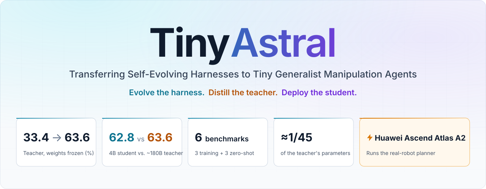
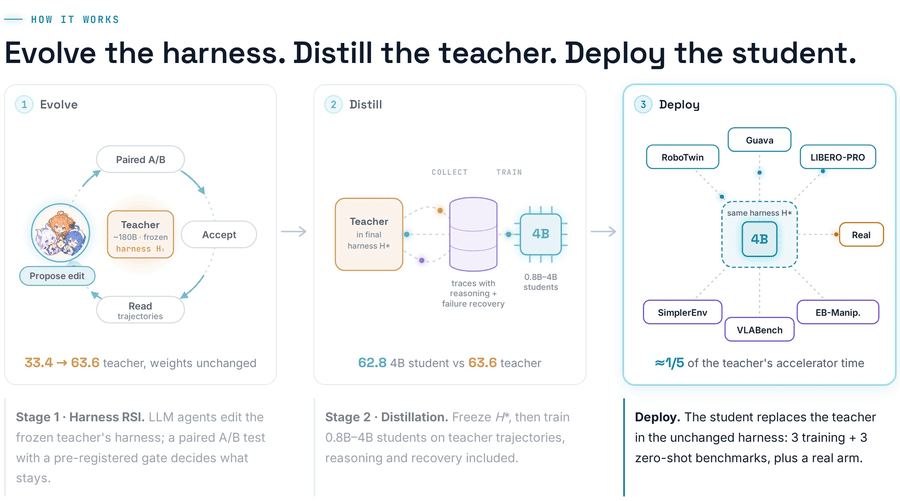
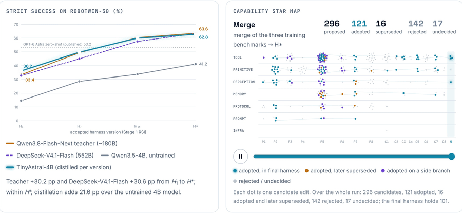
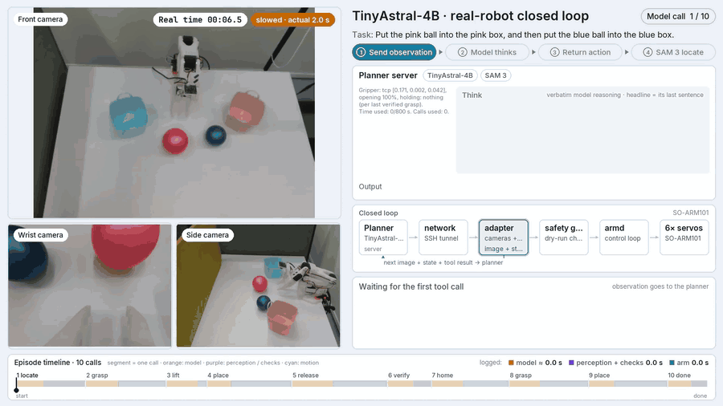
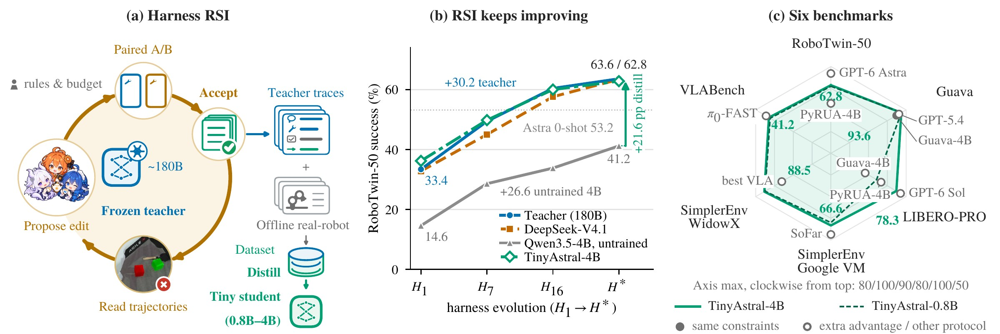

<div align="center">



Kehong Gong<sup>1</sup>, Xiaoxu Zheng<sup>1</sup>, Guanli Hou<sup>2</sup>, Seunghun Lee<sup>1</sup>, Mengqi Guo<sup>1</sup><br>
Runjia Tan<sup>3</sup>, Zhengyu Wen<sup>2</sup>, Qi Wang<sup>2</sup>, Xiaoyu He<sup>2</sup>, Mingyuan Zhang<sup>2,✉</sup>, Michael Bi Mi<sup>1</sup>

<sup>1</sup>Huawei Technologies Co., Ltd &nbsp;&nbsp; <sup>2</sup>Huawei Noah Research Institute &nbsp;&nbsp; <sup>3</sup>Independent Researcher &nbsp;&nbsp; <sup>✉</sup>Corresponding author

<br>

[](https://garfield-kh.github.io/TinyAstral/)
[](https://arxiv.org/abs/2610.41216)
[](https://huggingface.co/kehong/TinyAstral-weights)
[](https://huggingface.co/datasets/kehong/TinyAstral-SFT)

[](https://gitcode.com/cann/cann-recipes-embodied-ai)
[](#serving)

</div>

<br>

A frozen open-weight **~180B teacher** improves only through changes to its **harness** (tools, feedback, memory,
recovery): frontier LLM agents propose edits, and each edit is kept only if it passes a paired statistical test. On
RoboTwin this lifts the teacher from **33.4% to 63.6%**. Its trajectories, reasoning and failure recovery included, are
then distilled into **0.8B–4B students** that take its place in the same harness. **TinyAstral-4B reaches 62.8%**, stays
close to its teacher on six benchmarks with about **1/45 of its parameters**, and drives a real SO-ARM101 arm closed loop,
served on **Huawei Ascend Atlas A2**.

## Evolve → Distill → Deploy

<p align="center">
  
</p>

## Harness evolution

Accepted harness versions, measured on the same 500 RoboTwin-50 episodes. Left: success of each planner per version
(the first three keep their weights fixed; the student is distilled separately at each version). Right: every
candidate edit, by phase and category, as the run progresses.

<p align="center">
  
</p>

## Real robot

TinyAstral-4B drives a real SO-ARM101 arm closed loop, with the planner served on **Huawei Ascend Atlas A2**: it sees
the cameras, calls one tool at a time and reads each result.

<p align="center">
  
  <br>
  <sub>① <i>"Put the pink ball into the pink box, and then put the blue ball into the blue box."</i> (10 model calls)</sub>
  <br>
  <sub>② <i>"Stack blue tape on white tape, and then stack brown tape on blue tape."</i> (8 tool calls)</sub>
</p>

<sub>Each clip is a full recorded run: three cameras, the planner's output and every tool result, and the episode
timeline. Arm motion is fast-forwarded (the speed is shown on the video); the on-screen clock shows real elapsed time.
The same videos with chapter controls are on the <a href="https://garfield-kh.github.io/TinyAstral/#real">homepage</a>.</sub>

## Main results

<p align="center">
  
</p>


Success (%) with the same harness <i>H</i>\*. Training benchmarks use strict success <i>S</i> (the planner ends the
episode with `done` and the simulator's success predicate holds); zero-shot benchmarks use their official measures.

<table>
<thead>
<tr><th rowspan="2" align="left">Method</th><th colspan="3">Training benchmarks</th><th colspan="4">Zero-shot benchmarks</th></tr>
<tr><th>RoboTwin-50<br><sub>500 ep.</sub></th><th>Guava<br><sub>450 ep.</sub></th><th>LIBERO-PRO<br><sub>300 ep.</sub></th><th>SimplerEnv<br><sub>Google VM</sub></th><th>SimplerEnv<br><sub>WidowX</sub></th><th>VLABench<br><sub>500 ep.</sub></th><th>EB-Manip.<br><sub>228 ep.</sub></th></tr>
</thead>
<tbody>
<tr><td colspan="8"><sub><i>Strongest competitor run per training benchmark (same episodes, their official harnesses, run by us)</i></sub></td></tr>
<tr><td>Guava-4B</td><td align="center">–</td><td align="center">84.4</td><td align="center">–</td><td align="center">–</td><td align="center">–</td><td align="center">–</td><td align="center">–</td></tr>
<tr><td>PyRUA-Lean + Qwen3.8-Flash-Next</td><td align="center">18.2</td><td align="center">–</td><td align="center">53.0</td><td align="center">–</td><td align="center">–</td><td align="center">–</td><td align="center">–</td></tr>
<tr><td>SenseNova-RoboRSI-27B<sup>d</sup></td><td align="center">–</td><td align="center">–</td><td align="center">70.3</td><td align="center">–</td><td align="center">–</td><td align="center">–</td><td align="center">–</td></tr>
<tr><td colspan="8"><sub><i>Ours (same harness H*, strict protocol)</i></sub></td></tr>
<tr><td>Qwen3.5-4B, untrained</td><td align="center">41.2<sup>†</sup></td><td align="center">75.1</td><td align="center">36.3<sup>†</sup></td><td align="center">56.6</td><td align="center">86.5</td><td align="center">27.6</td><td align="center">21.9</td></tr>
<tr><td>Teacher: Qwen3.8-Flash-Next (180B)</td><td align="center">63.6</td><td align="center">94.7</td><td align="center">80.0</td><td align="center">69.2</td><td align="center">92.7</td><td align="center">46.2</td><td align="center">32.0</td></tr>
<tr><td>DeepSeek-V4.1-Flash (552B)</td><td align="center">63.4</td><td align="center">–</td><td align="center">70.3<sup>†</sup></td><td align="center">68.0</td><td align="center">86.5</td><td align="center">38.8</td><td align="center">29.8</td></tr>
<tr><td>TinyAstral-0.8B</td><td align="center">61.8</td><td align="center">93.8</td><td align="center">54.7</td><td align="center">64.0</td><td align="center">87.5</td><td align="center">40.4</td><td align="center">24.6</td></tr>
<tr><td>TinyAstral-2B</td><td align="center">59.8</td><td align="center">88.0</td><td align="center">69.0</td><td align="center">65.4</td><td align="center">88.5</td><td align="center">42.0</td><td align="center">25.0</td></tr>
<tr><td><b>TinyAstral-4B</b></td><td align="center"><b>62.8</b></td><td align="center"><b>93.6</b></td><td align="center"><b>78.3</b></td><td align="center"><b>66.6</b></td><td align="center"><b>88.5</b></td><td align="center"><b>41.2</b></td><td align="center"><b>27.6</b></td></tr>
</tbody>
</table>

<sub><sup>d</sup> Stop on success. <sup>†</sup> &gt;5% unknown outcomes, counted as failures. –: unavailable.</sub>

<details>
<summary><b>Full table: published results, competitor runs and evaluation conditions</b></summary>

<br>

Conditions: **O** open, **C** no closed LLM, **S** no success signal, **I** no ICL demo, **E** no expert demo
(✓ satisfied, ✗ not satisfied).

| Method | O | C | S | I | E | RoboTwin-50 | Guava | LIBERO-PRO | SimplerEnv Google VM | SimplerEnv WidowX | VLABench | EB-Manip. |
|:---|:-:|:-:|:-:|:-:|:-:|:-:|:-:|:-:|:-:|:-:|:-:|:-:|
| <sub>*Published results (their protocols and episodes)*</sub> | | | | | | | | | | | | |
| GPT-6 Astra, one-shot | ✗ | ✗ | ✗ | ✗ | ✓ | 73.6 | – | – | – | – | – | – |
| PyRUA-Lean, GPT-6 Astra | ✗ | ✗ | ✗ | ✓ | ✗ | 69.2 | – | – | – | – | – | – |
| GPT-6 Astra, zero-shot | ✗ | ✗ | ✗ | ✓ | ✓ | 53.2 | – | – | – | – | – | – |
| GPT-5.4, Guava harness | ✗ | ✗ | ✓ | ✓ | ✓ | – | 90.4 | – | – | – | – | – |
| MotorMind, GPT-6 Sol | ✗ | ✗ | ✗ | ✓ | ✓ | – | – | 83.3<sup>a</sup> | – | – | – | – |
| World Action Agent, Gemini 3.7 Flash | ✗ | ✗ | ✗ | ✓ | ✗ | – | – | 75.6<sup>f</sup> | – | – | – | – |
| World Action Agent, Qwen3.5-9B student | ✗ | ✗ | ✗ | ✓ | ✗ | – | – | 43.3<sup>f</sup> | – | – | – | – |
| SoFar, GPT-4o | ✗ | ✗ | ✓ | ✓ | ✓ | – | – | – | 74.9 | 58.3 | – | – |
| π<sub>0</sub>-FAST, fine-tuned | ✓ | ✓ | ✓ | ✓ | ✗ | – | – | – | 61.9 | 32.1 | 43.1 | – |
| GPT-4o, EmbodiedBench<sup>b</sup> | ✗ | ✗ | ✓ | ✗ | ✓ | – | – | – | – | – | – | 28.9 |
| <sub>*Same episodes, competitors' official harnesses, run by us*</sub> | | | | | | | | | | | | |
| PyRUA-Lean-4B | ✓ | ✓ | ✓ | ✓ | ✗ | 12.8 | – | 17.7<sup>e</sup> | – | – | – | – |
| Guava-4B | ✓ | ✓ | ✓ | ✓ | ✓ | – | 84.4 | – | – | – | – | – |
| MotorMind + Qwen3.8-Flash-Next<sup>c</sup> | ✓ | ✓ | ✗ | ✓ | ✓ | – | – | 57.3 | – | – | – | – |
| PyRUA-Lean + Qwen3.8-Flash-Next | ✓ | ✓ | ✓ | ✓ | ✗ | 18.2 | – | 53.0 | – | – | – | – |
| Guava harness + Qwen3.8-Flash-Next | ✓ | ✓ | ✓ | ✓ | ✓ | – | 78.9 | – | – | – | – | – |
| SenseNova-RoboRSI-27B<sup>d</sup> | ✓ | ✓ | ✗ | ✓ | ✓ | – | – | 70.3 | – | – | – | – |
| <sub>*Ours (same harness H\*, strict protocol)*</sub> | | | | | | | | | | | | |
| Qwen3.5-4B, untrained | ✓ | ✓ | ✓ | ✓ | ✓ | 41.2<sup>†</sup> | 75.1 | 36.3<sup>†</sup> | 56.6 | 86.5 | 27.6 | 21.9 |
| Teacher: Qwen3.8-Flash-Next (180B) | ✓ | ✓ | ✓ | ✓ | ✓ | 63.6 | 94.7 | 80.0 | 69.2 | 92.7 | 46.2 | 32.0 |
| DeepSeek-V4.1-Flash (552B) | ✓ | ✓ | ✓ | ✓ | ✓ | 63.4 | – | 70.3<sup>†</sup> | 68.0 | 86.5 | 38.8 | 29.8 |
| TinyAstral-0.8B | ✓ | ✓ | ✓ | ✓ | ✓ | 61.8 | 93.8 | 54.7 | 64.0 | 87.5 | 40.4 | 24.6 |
| TinyAstral-2B | ✓ | ✓ | ✓ | ✓ | ✓ | 59.8 | 88.0 | 69.0 | 65.4 | 88.5 | 42.0 | 25.0 |
| **TinyAstral-4B** | ✓ | ✓ | ✓ | ✓ | ✓ | **62.8** | **93.6** | **78.3** | **66.6** | **88.5** | **41.2** | **27.6** |

<sub><sup>a</sup> Original LIBERO suites, single seed. <sup>b</sup> Ground-truth coordinates, boxes, and in-context
examples. <sup>c,d</sup> Stop on success. <sup>e</sup> Final-state success only, without requiring a successful finish
declaration. <sup>f</sup> Position and task perturbations only (360 episodes), simulator point clouds; the student is
trained on rollouts of the same tasks and tested on unseen seeds. <sup>†</sup> &gt;5% unknown outcomes, counted as
failures.</sub>

</details>

## Code

The harness <i>H</i>\* is one design: **the planner decides what to do, the tools decide how**, behind a single entry
point, `harness/run.py`. It has two implementations, single-arm and bimanual, each frozen so that the paper's numbers
reproduce. `rsi/` is the loop that evolved the harness.

<details>
<summary><b>Repository structure</b></summary>

```
harness/                 the harness H*
  run.py                 the one entry point: run.py robotwin | guava | libero
  single_arm/            one-arm H*, shared by Guava and LIBERO-PRO (and the zero-shot drivers)
    planner.py           planner loop, semantic tool layer, episode drivers
    prompts.py           SYSTEM prompts
    flags.py             tool-layer improvements selected with --gen
  bimanual/              two-arm H* for RoboTwin: planner.py on planner_base.py, geometry.py, perception*.py,
                         camera_capture.py, scene_runner.py + scene/ (RoboTwin scene construction)
  adapters/              simulator adapters (RoboTwin, Guava, LIBERO-PRO) and the Guava / LIBERO-PRO episode
                         protocols (seeds, budgets, cameras, scoring)
  tools.py, geom.py      execution layer and shape geometry shared by both implementations
  paths.py               locations and sys.path setup
  memory/robotwin/       per-task notes shown at the first RoboTwin turn
  data/robotwin_seedcache/  valid RoboTwin seeds per task (defines the 500 evaluation episodes)
rsi/                     harness RSI: rules, seed splits, paired acceptance gate, ledger, toy example
eval/                    runners and the strict-success scorer for RoboTwin-50 / Guava / LIBERO-PRO
zeroshot/                SimplerEnv, VLABench, EB-Manipulation drivers and scorers (held out from RSI and training)
perception/              SAM3 HTTP server (CUDA and Huawei Ascend Atlas A2)
serving/                 vLLM (GPU) and SGLang (Huawei Ascend Atlas A2) launch scripts, SAM3 launchers
train/                   ms-swift recipe of the released students
tests/                   request-equivalence checks against the code used for the paper
docs/                    per-benchmark installation, serving, Huawei Ascend Atlas A2, training, consistency
assets/                  figures for this README
```

</details>

<details>
<summary><b>Install</b></summary>

<br>

Three kinds of processes, on one machine or several: the planner model (vLLM on GPU, or SGLang on Huawei Ascend Atlas
A2), a SAM3 server, and episode workers (one conda env per benchmark). The harness has no install step; paths are set
with environment variables. Full instructions: [INSTALL.md](INSTALL.md).

| | where |
|---|---|
| TinyAstral-4B / 2B / 0.8B | Hugging Face [`kehong/TinyAstral-weights`](https://huggingface.co/kehong/TinyAstral-weights), sub-folders `4b/`, `2b/`, `0.8b/` |
| SFT data | Hugging Face dataset [`kehong/TinyAstral-SFT`](https://huggingface.co/datasets/kehong/TinyAstral-SFT) |
| SAM3 | Hugging Face `facebook/sam3` (gated, SAM License); download it yourself |

Any OpenAI-compatible endpoint can be plugged in as the planner (`--url`, `--model`).

```bash
git clone <this repository> tinyastral && cd tinyastral
mkdir -p third_party runs weights
huggingface-cli download kehong/TinyAstral-weights --include "4b/*" --local-dir weights
```

</details>

<details>
<summary><b>Quick start: one LIBERO-PRO episode</b></summary>

```bash
# 1. planner: TinyAstral-4B on one NVIDIA GPU (vLLM), served as "qwen" on :8000
bash serving/gpu/serve_student_vllm.sh weights/4b 8000

# 2. SAM3 (/seg API)
SAM3_CKPT=/path/to/sam3.pt bash serving/sam3/sam3_gpu.sh 8134

# 3. one episode, then the full 300-episode set and its score
export TINYASTRAL_URL=http://127.0.0.1:8000/v1 LIBERO_SAM3_URL=http://127.0.0.1:8134
python harness/run.py libero --gen default --task 57 --seed 1 --out runs/libero_4b --model qwen --thinking 1 --xml-calls 1
python eval/run_libero.py --label 4b --workers 4 && python eval/score.py libero runs/libero_4b
```

</details>

<details>
<summary><b>Evaluation on the six benchmarks</b></summary>

<br>

| benchmark | episodes | measure | runner / scorer | install and protocol |
|---|---|---|---|---|
| RoboTwin-50 | 500 (50 tasks × 10) | strict success S | `eval/run_robotwin.py`, `eval/score.py robotwin` | [docs/benchmarks/robotwin.md](docs/benchmarks/robotwin.md) |
| Guava | 450 (15 tasks × 30) | strict success S | `eval/run_guava.py`, `eval/score.py guava` | [docs/benchmarks/guava.md](docs/benchmarks/guava.md) |
| LIBERO-PRO | 300 | strict success S | `eval/run_libero.py`, `eval/score.py libero` | [docs/benchmarks/libero_pro.md](docs/benchmarks/libero_pro.md) |
| SimplerEnv (Google VM, WidowX) | 960 | official success | `zeroshot/simplerenv/run_all.py`, `score_simplerenv.py` | [docs/benchmarks/simplerenv.md](docs/benchmarks/simplerenv.md) |
| VLABench | 500 | official success | `zeroshot/vlabench/run_all.py`, `score_vlabench.py` | [docs/benchmarks/vlabench.md](docs/benchmarks/vlabench.md) |
| EB-Manipulation | 228 | official success | `zeroshot/embodiedbench/run_all.py`, `score_eb.py` | [docs/benchmarks/embodiedbench.md](docs/benchmarks/embodiedbench.md) |

```bash
# RoboTwin-50: one episode, then all 500 (resumable; one process per episode)
python harness/run.py robotwin --task adjust_bottle --episode 0 --lane tinyastral4b --model qwen
python eval/run_robotwin.py --lane tinyastral4b --workers 4

# Guava (450) and LIBERO-PRO (300)
python eval/run_guava.py  --label tinyastral4b --workers 4
python eval/run_libero.py --label tinyastral4b --workers 4

# score (outputs under $TINYASTRAL_OUT, default runs/)
python eval/score.py robotwin runs/tinyastral4b
python eval/score.py guava    runs/guava_tinyastral4b
python eval/score.py libero   runs/libero_tinyastral4b
```

Strict success S: the planner itself ends the episode with `done` and the simulator's success predicate holds at the
end; the simulator's success signal is never shown to the planner. Unknown outcomes count as failures. Episodes have
wall-clock budgets (RoboTwin 900 s, LIBERO-PRO 450 s); the paper runs used one bf16 vLLM replica per GPU.

`tests/equiv_train.py` and `tests/equiv_zeroshot.py` run one fixed episode per benchmark against a local stub endpoint
and check that the step-0 planner request (SYSTEM prompt, tool descriptions, task note, user turn, sampling parameters)
matches the code used for the paper byte for byte.
`tests/equiv_replay.py --bench <bench> --old-root <older checkout> [--ctrl]` replays whole episodes (scripted planner
replies from `tests/replay_cases.json`) through two checkouts and compares every request and the episode files; `--ctrl`
also runs the older checkout twice to separate renderer / simulator nondeterminism from code changes.

</details>

<details id="serving">
<summary><b>Serving: GPU / Huawei Ascend Atlas A2</b></summary>

<br>

**NVIDIA GPU (vLLM)**

```bash
bash serving/gpu/serve_student_vllm.sh weights/4b 8000           # served as "qwen" on :8000
SAM3_CKPT=/path/to/sam3.pt bash serving/sam3/sam3_gpu.sh 8134
```

**Huawei Ascend Atlas A2 (SGLang)**

```bash
bash serving/npu/npu_create_container.sh /dev/davinci0 8000      # once: container with one NPU
TA_MODEL=$PWD/weights/4b bash serving/npu/npu_start_server.sh 8000
SAM3_CKPT=/path/to/sam3.pt ASCEND_RT_VISIBLE_DEVICES=1 bash serving/sam3/sam3_npu.sh 8134
python3 serving/npu/smoke_service.py http://127.0.0.1:8000/v1 qwen reqs.jsonl   # smoke test with recorded requests
```

Both expose an OpenAI-compatible endpoint; the harness is the same. See [docs/serving.md](docs/serving.md) and
[docs/npu.md](docs/npu.md).

</details>

<details>
<summary><b>Training</b></summary>

<br>

`train/train.sh` reproduces the final-round ms-swift settings: full fine-tuning of Qwen3.5-0.8B / 2B / 4B with the
vision tower and aligner frozen, ZeRO-2, lr 1e-5 cosine, 2 epochs, max length 12288, global batch 32, loss on the last
round. See [docs/training.md](docs/training.md) and [docs/consistency.md](docs/consistency.md).

```bash
pip install -r train/requirements-train.txt
bash train/train.sh
```

</details>

<details>
<summary><b>Harness RSI</b></summary>

<br>

[`rsi/`](rsi/) is the loop that evolves the harness. The teacher is frozen (Qwen3.8-Flash-Next, ~180B, in the paper;
any OpenAI-compatible model works); the master that reads trajectories and proposes edits is pluggable (an LLM
endpoint, CLI agents or humans, or your own class). Rules and budget are fixed in advance; each candidate passes a
direction screen and a paired acceptance gate on fresh selection seeds (task-stratified bootstrap), and every
candidate, accepted or not, goes into an append-only capability ledger.

```bash
cd rsi
python -m rsi.loop --config examples/toy/rules.yaml     # toy benchmark: the full loop in seconds
python -m rsi.loop --config rules.yaml                  # your harness and benchmark
python -m unittest discover -s tests
```

See [rsi/README.md](rsi/README.md) for the mapping from the paper's protocol to the code.

</details>

## License

Code in this repository: [Apache-2.0](LICENSE). TinyAstral weights and the TinyAstral-SFT dataset: CC BY-NC-SA 4.0
(non-commercial). The dataset includes samples derived from AgiBot World (CC BY-NC-SA 4.0) and RH20T (partly CC BY-NC
4.0); the base models (Qwen3.5-0.8B / 2B / 4B) are Apache-2.0; teacher outputs in the data come from
Qwen3.8-Flash-Next and are subject to its license. Third-party models, simulators and benchmarks keep their own licenses
and are not redistributed; see [NOTICE](NOTICE).

## Citation

```bibtex
@article{gong2026tinyastral,
  title         = {TinyAstral: Transferring Self-Evolving Harnesses to Tiny Generalist Manipulation Agents},
  author        = {Gong, Kehong and Zheng, Xiaoxu and Hou, Guanli and Lee, Seunghun and Guo, Mengqi and Tan, Runjia and Wen, Zhengyu and Wang, Qi and He, Xiaoyu and Zhang, Mingyuan and Mi, Michael Bi},
  journal       = {arXiv preprint arXiv:2610.41216},
  year          = {2026},
  eprint        = {2610.41216},
  archivePrefix = {arXiv},
  primaryClass  = {cs.RO},
  url           = {https://arxiv.org/abs/2610.41216}
}
```
